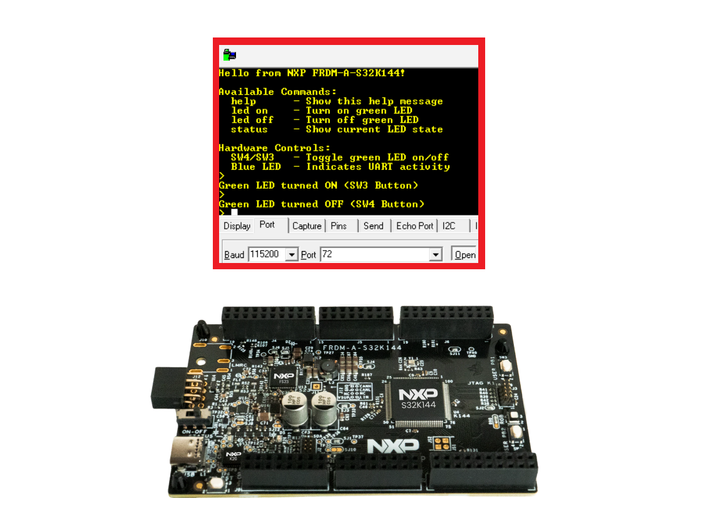
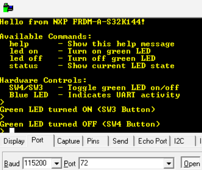

# NXP Application Code Hub
[](https://www.nxp.com)

## LED Control Using Buttons with Interactive UART Messages

This example demonstrates how to control the LED on the FRDM-A-S32K144 board using UART serial console. The application provides a text-based UART console with simple commands and also supports LED control via the onboard buttons SW4 and SW3.

[<p align="center"></p>](./images/FRDM-A-S32K144_Button_UART.png)

#### Boards: FRDM-A-S32K144
#### Categories: Low Power, User Interface
#### Peripherals: UART, GPIO
#### Toolchains: S32 Design Studio IDE

## Table of Contents
1. [Software and Tools](#step1)
2. [Hardware](#step2)
3. [Setup](#step3)
4. [Results](#step4)
5. [Support](#step5)
6. [Release Notes](#step6)

## 1. Software and Tools<a name="step1"></a>

This example was developed using the FRDM Automotive Bundle for S32K1. To download and install the complete software and tools ecosystem, use the following link:
- [S32K1 FRDM Automotive Board Installation Package](https://www.nxp.com/app-autopackagemgr/automotive-software-package-manager:AUTO-SW-PACKAGE-MANAGER?currentTab=0&selectedDevices=S32K1&applicationVersionID=155)

## 2. Hardware<a name="step2"></a>

### 2.1 Required Hardware
- Personal Computer
- Micro-USB cable
- [FRDM-A-S32K144](https://www.nxp.com/design/design-center/development-boards-and-designs/FRDM-A-S32K144)
<p></p>

### 2.2 Board Pin Mapping

| Signal      | MCU Pin | Direction |
|-------------|---------|-----------|
| LPUART1 RX  | PTC6    | Input     |
| LPUART1 TX  | PTC7    | Output    |
| LED Green   | PTB13   | Output    |
| LED Blue    | PTB12   | Output    |
| LED Red     | PTE7    | Output    |
| SW4 Button  | PTD4    | Input     |
| SW3 Button  | PTD5    | Input     |

LEDs are active-high. Buttons are active-low (internal pull-up enabled).

### 2.2 Debugger Connection
- Connect the Type-C USB cable to PC and FRDM-A-S32K144 board for power supply and debugging

## 3. Setup<a name="step3"></a>

### 3.1 Import the Project into S32 Design Studio IDE
1. Open S32 Design Studio IDE, in the Dashboard Panel, choose **Import project from Application Code Hub**.
   [<p align="center"></p>](./images/import_project_1.png)

2. Find the demo by searching: [LED Control Using Buttons with Interactive UART Messages](https://mcuxpresso.nxp.com/appcodehub?search=dm-uart-button-S32K144)
3. Open the project, click the **GitHub link**, S32 Design Studio IDE will automatically retrieve project attributes, then click **Next>**.
    [<p align="center"></p>](./images/import_project_3.png)

4. Select **main** branch and then click **Next>**.

5. Select your local path for the repo in **Destination->Directory:** window. The S32 Design Studio IDE will clone the repo into this path, click **Next>**.

6. Select **Import existing Eclipse projects** then click **Next>**.

7. Select the project in this repo (only one project in this repo) then click **Finish**.

### 3.2 Generating, Building and Running the Example
1. In Project Explorer, right-click the project and select **Update Code and Build Project**. This will generate the configuration (Pins, Clocks, Peripherals), update the source code and build the project using the active configuration (e.g. Debug_FLASH).
Make sure the build completes successfully and the *.elf file is generated without errors.
[<p align="center"></p>](./images/update_and_build.png)
Press **Yes** in the **SDK Component Management** pop-up window to continue.

2. Go to **Debug** and select **Debug Configurations**. There will be a debug configuration for this project:
[<p align="center"></p>](./images/Debug_config.png)

        Configuration Name                  Description
        -------------------------------     -----------------------
        $(example)_debug_flash_pemicro      Debug the FLASH configuration using PEmicro probe

    Select the desired debug configuration and click on **Debug**. Now the perspective will change to the **Debug Perspective**.
    Use the controls to control the program flow.
3. The IDE switches to the Debug perspective. Use the Run/Resume control to start execution.

## 4. Results<a name="step4"></a>

Open a serial terminal on the enumerated COM port with the following settings:

| Parameter  | Value  |
|------------|--------|
| Baud rate  | 115200 |
| Data bits  | 8      |
| Parity     | None   |
| Stop bits  | 1      |
| Flow ctrl  | None   |

After reset, the board prints the welcome banner and a command prompt:
[<p></p>](./images/FRDM-A-S32K144_Button_UART_Terminal.png)

```
Hello from NXP FRDM-A-S32K144!

Available Commands:
  help      - Show this help message
  led on    - Turn on green LED
  led off   - Turn off green LED
  status    - Show current LED state

Hardware Controls:
  SW4/SW3   - Toggle green LED on/off
  Blue LED  - Indicates UART activity
>
```

### Supported UART Commands

| Command   | Description                           |
|-----------|---------------------------------------|
| `help`    | Display the list of available commands|
| `led on`  | Turn the green LED on                 |
| `led off` | Turn the green LED off                |
| `status`  | Print the current green LED state     |

### Hardware Button Control

- **SW4 (PTD4)**: Toggles the green LED on/off. A message is printed on the terminal.
- **SW3 (PTD5)**: Toggles the green LED on/off. A message is printed on the terminal.
- **Blue LED (PTB12)**: Blinks briefly each time a UART command is processed.

## 5. Support<a name="step5"></a>

For general technical questions related to NXP microcontrollers, please use the *NXP Community Forum*.

#### Project Metadata

<!----- Boards ----->
[](https://mcuxpresso.nxp.com/appcodehub?hwBoard=FRDM-A-S32K144)

<!----- Categories ----->
[](https://mcuxpresso.nxp.com/appcodehub?category=low_power)
[](https://mcuxpresso.nxp.com/appcodehub?category=ui)

<!----- Peripherals ----->
[](https://mcuxpresso.nxp.com/appcodehub?peripheral=uart)
[](https://mcuxpresso.nxp.com/appcodehub?peripheral=gpio)

<!----- Toolchains ----->
[](https://mcuxpresso.nxp.com/appcodehub?toolchain=s32_design_studio_ide)

Questions regarding the content/correctness of this example can be entered as Issues within this GitHub repository.

>**Note**: For more general technical questions regarding NXP Microcontrollers and the difference in expected functionality, enter your questions on the [NXP Community Forum](https://community.nxp.com/)

[](https://www.youtube.com/NXP_Semiconductors)
[](https://www.linkedin.com/company/nxp-semiconductors)
[](https://www.facebook.com/nxpsemi/)
[](https://x.com/NXP)

## 6. Release Notes<a name="step6"></a>

| Version | Description / Update                           | Date                         |
|:-------:|------------------------------------------------|-----------------------------:|
| 1.0     | Initial release on Application Code Hub        | October 28<sup>th</sup> 2026 |
